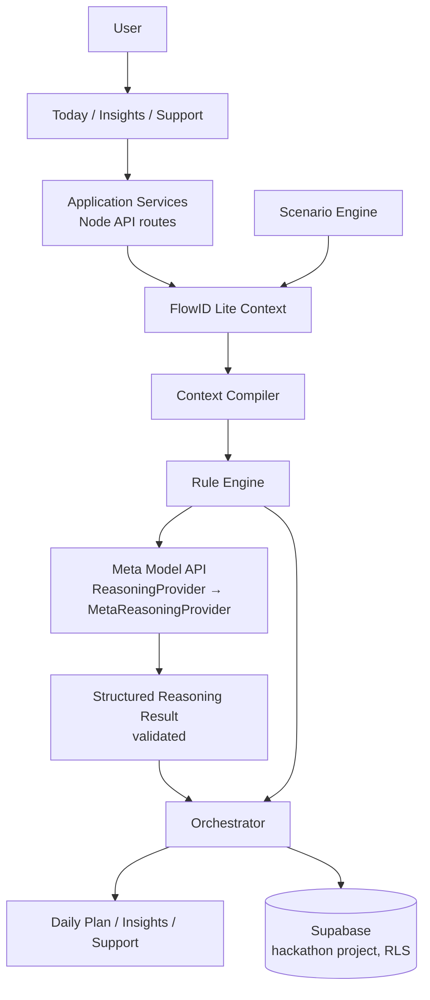

# Glyth Snapshot

> Glyth understands the user's context, detects when something meaningful changes, reasons about the consequences across their life, and adapts the day accordingly.

A **clean-room, standalone hackathon prototype** (10-day build). It is inspired only by Glyth's product philosophy — no Glyth production code, assets, schema, APIs, environment variables, or infrastructure are used or referenced. If the main Glyth repository disappeared, this project would still build and run.

## The demo (30 seconds)

1. Open the app → **Today**: readiness, focus priorities, adaptive plan.
2. Go to **Insights → Poor Sleep** (sleep 4h 42m vs 7h 15m baseline, 3rd poor night, hard training yesterday).
3. Back on **Today**: heavy strength → 08:00 recovery session, deep work protected, recovery/meal added, admin deferred. **"Your day changed — 3 adjustments made."**
4. Tap **Why?** — observed facts vs baseline, likely impact, response. No chain-of-thought, no causal over-claiming (`observed` / `inferred` / `heuristic` stay distinct in the data).
5. **Accept / Reject** a recommendation (reject reverts the plan item), or **Ask Glyth**: *"Keep my workout"* → typed proposal → confirm → plan updates.
6. **Insights**: key insight and reasoning. **Support**: goals, trajectories, intervention history, and weekly summary.
7. **Reset demo** (top right) → original state, every time.

## Architecture



**Stack (as built):** zero-dependency Node ≥20 API server + vanilla ES-module frontend sharing one typed domain engine (`src/domain/engine.js`, JSDoc + strict `checkJs`), Supabase Postgres migrations (for the deployed version), Meta Model API behind a provider adapter. This was chosen over a Next.js scaffold for hackathon reliability: it runs anywhere with `node server/server.js`, with no install step, and the same engine powers the static-hosting fallback. The API surface maps 1:1 onto Next.js route handlers / Vercel functions if migrated.

**AI:** Meta Model API (checked against official docs, 26 Oct 2026): base `https://api.meta.ai/v1`, `Authorization: Bearer $MODEL_API_KEY`, OpenAI-compatible `POST /chat/completions`, model from `META_MODEL` (default `muse-spark-1.1`). The model only *enriches explanations* over a compact compiled context; deterministic rules are authoritative, output is schema-validated, and any failure falls back to deterministic reasoning while logging provider/latency/validation to `ai_runs`.

## Run it

```bash
node server/server.js        # http://127.0.0.1:3000  (API + static)
# or static-only (e.g. locked-down machines):
python3 -m http.server 8123  # http://127.0.0.1:8123  (in-browser engine fallback)
npm test                     # 10 tests, node:test
```

`DEMO_MODE=true` (default): deterministic synthetic persona "Alex", scenarios always work, no credentials needed.

## Environment variables

See `.env.example`. Server-side only: `MODEL_API_KEY`, `META_MODEL`, `META_API_BASE_URL`, `SUPABASE_SERVICE_ROLE_KEY`. Public: `NEXT_PUBLIC_SUPABASE_URL`, `NEXT_PUBLIC_SUPABASE_ANON_KEY`. **No production Glyth variables are used.**

## Database

`supabase/migrations/202610260001_snapshot_schema.sql` — `profiles, goals, routines, signals, daily_states, calendar_events, daily_plan_items, insights, recommendations, interventions, scenario_runs, ai_runs, conversation_threads, conversation_messages`. Every user table has `user_id`, timestamps where appropriate, indexes, and owner-only RLS. Apply only to a **dedicated hackathon Supabase project**. `supabase/seed.sql` documents the synthetic persona.

## API

`GET /api/state` · `GET /api/flowid` · `POST /api/orchestrate` · `POST /api/scenario {scenario|reset}` · `POST /api/reset` · `POST /api/recommendation {id, decision}` · `POST /api/ask {message}` · `POST /api/proposal/confirm`

Ask Glyth mutations are typed proposals requiring confirmation — freeform model text can never mutate state.

## Scenarios

Poor Sleep (hero) · Heavy Workload · Hard Training · Important Meeting · Travel Day · Reset. Each persists a scenario run with before/after state and the resulting reasoning (in Supabase mode; in-memory in demo mode).

## Security & clean-room verification

- Server secrets never reach the browser; the frontend calls only `/api/*`.
- No code, components, assets, schema, prompts, or config were copied from Glyth; no Glyth API, database, or env var is referenced anywhere in this repo (verify: `grep -ri "glyth-new\|fgpbywfigfpbbhnwlwng" .` → nothing).
- Calendar sits behind `CalendarProvider` with `LocalCalendarProvider`; Google Calendar is a future plug-in, deliberately not built.

## Limitations

In-memory demo store (Supabase wiring is schema-complete but the hackathon server keeps state in memory); Ask Glyth intent parsing is deterministic, not LLM-based; Meta enrichment requires a Model API key and falls back gracefully without one; no auth in demo mode; trajectories/weekly summary are seeded, not computed from months of data.

## Future extensions

Supabase Auth + live RLS-backed persistence, GoogleCalendarProvider, richer Ask Glyth via the Meta provider with the same typed-proposal gate, wearable signal ingestion, and a Next.js port of the shell.

## UX inspiration

At the user's request, the Glyth main app was reviewed for high-level UX principles only: warm off-white canvas, flat warm surfaces, inverted pill actions, light-glass navigation, ring-led state, a single next-action hero, circular accept/dismiss controls, thin calm hierarchy, and 700ms ease-out state transitions. No code, components, assets, or styles were copied — this implementation is original CSS/JS expressing those principles.
## Employer dashboard

Employer command centre (Overview / Teams / Insights) extending the same UI: see `employer-dashboard/README.md` and `employer-dashboard/FINAL_REPORT.md`. Privacy-preserving aggregates only (`MIN_COHORT_SIZE = 5`), server-side role permissions, intervention lifecycle with outcomes. Demo: personal app → **Northstar ↗**.
